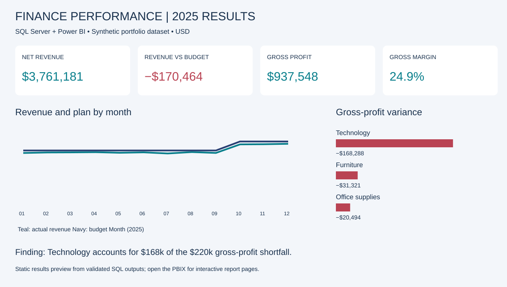

# Finance Performance Analysis — SQL Server & Power BI

An end-to-end finance analytics portfolio project investigating revenue, gross profit and budget variances for a fictional distributor.

**Tools:** SQL Server · T-SQL · Power Query · DAX · Power BI Desktop  
**Data:** 6,912 synthetic sales · 24 months (2024–2025) · 3 categories · 4 regions · USD

## Business question

Are revenue and gross profit on plan? Which categories and regions explain the shortfall, and what should management investigate?

## Key findings — 2025

| Metric | Result |
|---|---:|
| Net revenue | $3,761,180.89 |
| Budget revenue | $3,931,645.14 |
| Revenue variance | −$170,464.25 (−4.3%) |
| Gross profit | $937,548.24 |
| Gross margin | 24.9% versus 29.4% budget |
| Revenue growth over 2024 | 7.9% |

Technology contributes **$168,288** of the **$220,103 gross-profit shortfall**. Its discount rate is 9.0%, compared with 2.5% for the other categories. West has the largest regional revenue shortfall, at $93,162. Proposed actions are to review discount approvals, supplier costs and West Technology performance. These are hypotheses, not achieved savings.

## Explore the project

- **[Download the Power BI report](Finance_Performance.pbix?raw=true)** — two interactive report pages with imported data. Download and open in Power BI Desktop; GitHub does not render PBIX interactively.
- **[Read the SQL pipeline](sqlserver/01_Create_and_Load.sql)** — database setup, embedded synthetic data, constraints, monthly aggregation and validation.
- **[Review the finance analysis SQL](sqlserver/03_Finance_Analysis.sql)** — category drivers, regional rankings and year-over-year trends.
- **[Read the management briefing](docs/FINDINGS.md)** and **[data dictionary](docs/DATA_DICTIONARY.md)**.
- **[Inspect DAX measures](docs/MEASURES.dax)** and **[validation evidence](analysis/sqlserver_validation.json)**.

## Report pages

**Financial overview:** revenue, budget variance, gross profit, gross margin and YoY cards; monthly actual-versus-budget lines; category profit comparison; regional performance table.

**Variance investigation:** gross-profit variance waterfall; monthly margin versus plan; category/region drivers with discount rates and margin differences in percentage points.

The saved PBIX opens on 2025. Year, category and region slicers are independent on each page. Select one year when interpreting YoY growth; 2024 has no prior-year data.

## Technical approach

Synthetic transaction data → SQL Server staging tables → SQL CTE aggregation → monthly finance view → Power Query SQL connector → star model → DAX → report pages.

Transactions are aggregated **before** joining budgets to avoid multiplying planned values. Actual and budget keys are combined so source-only combinations remain visible. Source amounts use integer cents; the SQL reporting view uses decimal(19,2). Margins are ratios of totals, not averages of row percentages. Window functions include LAG and DENSE_RANK.

## Run locally

1. Open `sqlserver/01_Create_and_Load.sql` in SSMS and execute on your own SQL Server instance. It creates `FinancePortfolio2025` with the source data embedded. Run setup once; it stops loading if project tables already exist.
2. Run `sqlserver/02_Validate.sql` and `sqlserver/03_Finance_Analysis.sql`.
3. Download and open `Finance_Performance.pbix`. Imported data is included, so viewing does not require SQL Server.
4. To refresh on your computer, update the SQL Server connection through Power BI data source settings / Power Query and authenticate with your own credentials. The saved report references the original local instance; no passwords are included.

## Validation

All **nine SQL Server assertions passed** in SSMS: row counts, unique fact grain, source coverage, revenue/budget reconciliation, transaction reconciliation and complete calendar. Power BI refreshed from SQL Server; both pages were visually checked and 2025 totals reconciled against SQL outputs. Validation records and exact analysis CSVs are in `analysis/`.

## Scope and disclosure

This is an AI-assisted personal learning project using **entirely synthetic data**, not employer or client work. The data generator deliberately introduces Technology discount/cost pressure and a West Technology shortfall. Findings demonstrate analytical methods rather than independent research. Gross profit excludes operating expenses, tax and financing; the dataset does not support net profit, cash-flow or price-volume conclusions. Fact grain is monthly.
